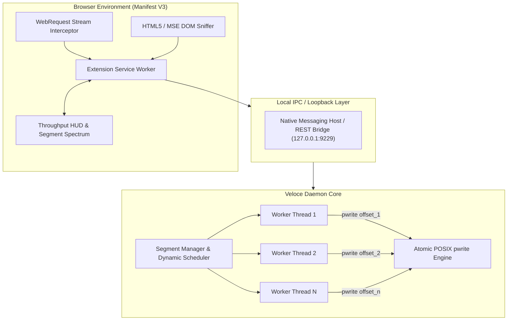

# Veloce

### High-Performance Dynamic Multi-Stream Download Accelerator & Media Sniffer

Veloce is a clean-room, open-source download accelerator and stream extraction engine designed to saturate network bandwidth through dynamic work-stealing segmentation, atomic in-place disk allocation, and direct browser network-layer stream interception.

---

## 1. Architectural Principles

Most multi-connection downloaders partition a target resource into static byte ranges at initiation. When any single connection suffers from TCP window decay, jitter, or server-side throttling, the overall download speed drops to the throughput of the slowest connection.

Veloce addresses this bottleneck through runtime dynamic bisection:

| Metric | Single-Stream Client | Static Segmentation (Aria2 default) | Veloce Engine |
| :--- | :--- | :--- | :--- |
| **Partitioning** | None (sequential stream) | Static cuts ($N$ fixed segments) | **Dynamic Work-Stealing Bisection** |
| **Slow Thread Recovery** | None | Idle threads remain unallocated | **Active thread splits slowest slice** |
| **Disk Serialization** | Sequential write | Sequential concatenation (`cat part* > file`) | **Atomic In-Place POSIX `pwrite`** |
| **Filesystem Safety** | Unchecked growth | Post-allocation failure | **`posix_fallocate` contiguous blocks** |
| **Browser Integration** | Standard browser engine | External application launcher | **Manifest V3 + WebRequest Media Sniffer** |

---

## 2. Dynamic Work-Stealing Engine



### Segment Bisection Algorithm
When an active connection thread completes its allocated byte range:
1. The `SegmentManager` acquires a synchronization lock and searches for the active segment with the largest remaining byte delta:
   $$\Delta_{\text{rem}} = S_{\text{end}} - S_{\text{current}} + 1$$
2. If $\Delta_{\text{rem}} \ge 2 \times \text{MIN\_SPLIT\_SIZE}$ (1 MB threshold):
   $$\text{split\_point} = S_{\text{current}} + \lfloor \frac{\Delta_{\text{rem}}}{2} \rfloor$$
3. The existing worker's boundary is clamped to $\text{split\_point}$.
4. A new segment spanning $[\text{split\_point} + 1, S_{\text{end}}]$ is dispatched immediately to the idle thread via an HTTP `Range: bytes=start-end` request.

### In-Place Atomic Disk I/O
Traditional tools write partial segments into temporary files (`part0.tmp`, `part1.tmp`) and perform an expensive sequential file copy upon reaching 100%. Veloce pre-allocates the complete file image using `posix_fallocate(2)` and uses `os.pwrite(fd, data, offset)` for atomic, non-locking disk writes directly into the final destination.

---

## 3. Universal Media & Stream Sniffer

Modern streaming architectures (YouTube, Vimeo, Twitch, CDN media hosts) deliver fragmented streams via **Media Source Extensions (MSE)** using:
- **HLS**: HTTP Live Streaming (`.m3u8` master and variant playlists)
- **MPEG-DASH**: Dynamic Adaptive Streaming over HTTP (`.mpd` manifests)

Veloce intercepts these streams at the browser network layer using `chrome.webRequest` header inspection. 

When a media resource is detected:
1. The manifest is probed for all available resolutions, codec configurations, and audio bitrates.
2. The user can select **Balanced / Lightweight (720p)**, **Full HD (1080p)**, or **Audio Extraction (MP3 / M4A)**.
3. Streams are multiplexed on-the-fly into an `.mp4` container using `ffmpeg` and `yt-dlp`.

---

## 4. Repository Structure

```
.
|-- README.md                     # Technical architecture and specifications
|-- main.py                       # Unified CLI and daemon entrypoint
|-- engine/
|   |-- segmenter.py              # Dynamic segment scheduler and atomic disk writer
|   |-- media.py                  # Universal stream prober and audio extractor
|   |-- server.py                 # Loopback REST and WebSocket bridge
|-- extension/
|   |-- manifest.json             # Chromium / Firefox Manifest V3 manifest
|   |-- icons/                    # Vector-rendered application icons
|   `-- src/
|       |-- background.js         # Network stream sniffer and download interceptor
|       |-- content.js            # In-page media hook and stream selector dialog
|       |-- content.css           # Modal overlay and floating button styles
|       |-- popup.html            # Extension dashboard and throughput HUD
|       |-- popup.css             # Glassmorphism design system
|       `-- popup.js              # Real-time spectrum renderer and task manager
|-- native_host/
|   |-- native_host.py            # Standard I/O Native Messaging binary
|   `-- install_native_host.sh    # Host manifest registrar script
`-- tests/
    `-- test_segmenter.py         # Thread-safe segmentation unit tests
```

---

## 5. Usage

### Starting the Core Daemon
```bash
python3 main.py daemon --port 9229 --host 127.0.0.1
```

### Loading the Browser Extension
1. Open `chrome://extensions` in Chromium, Chrome, Brave, or Edge.
2. Toggle **Developer mode** on.
3. Click **Load unpacked** and select the `extension/` directory.

### Native Messaging Registration (Optional)
To register the browser native host on Linux:
```bash
./native_host/install_native_host.sh
```

### Command-Line Downloads
```bash
# Accelerated multi-connection transfer
python3 main.py download https://example.com/disk_image.iso -c 16 -o ~/Downloads/
```

---

## 6. Verification

Run the test suite to verify dynamic segment allocation and bisection math:
```bash
python3 -m unittest discover -s tests
```

---

## 7. License

Released under the **MIT License**. Authored by **Firoj Paudel** (`firojpaudel@gmail.com`).
