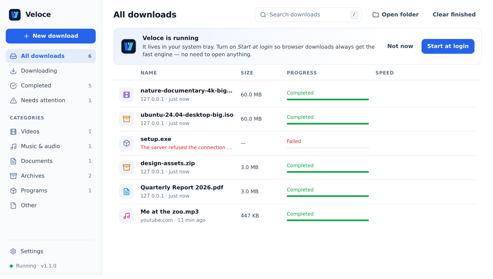
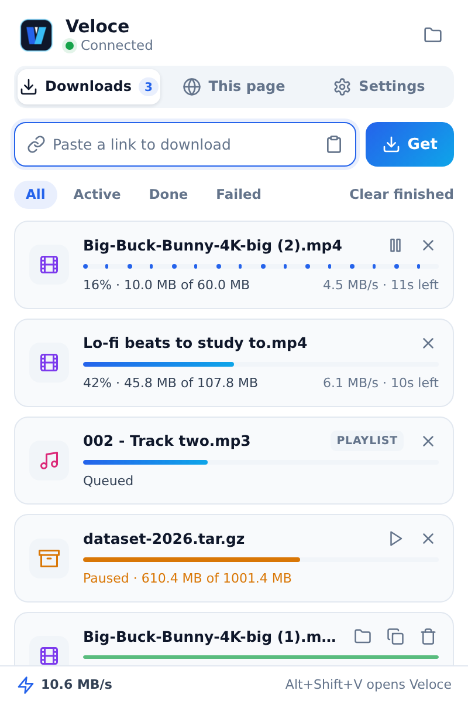
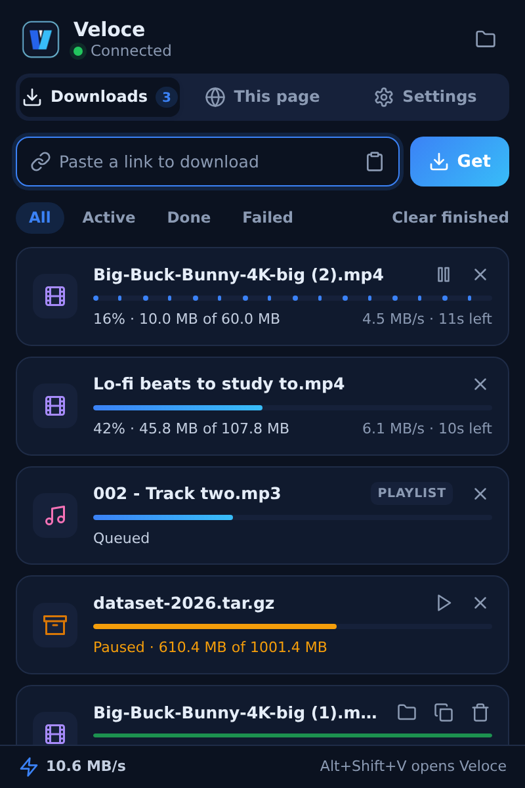
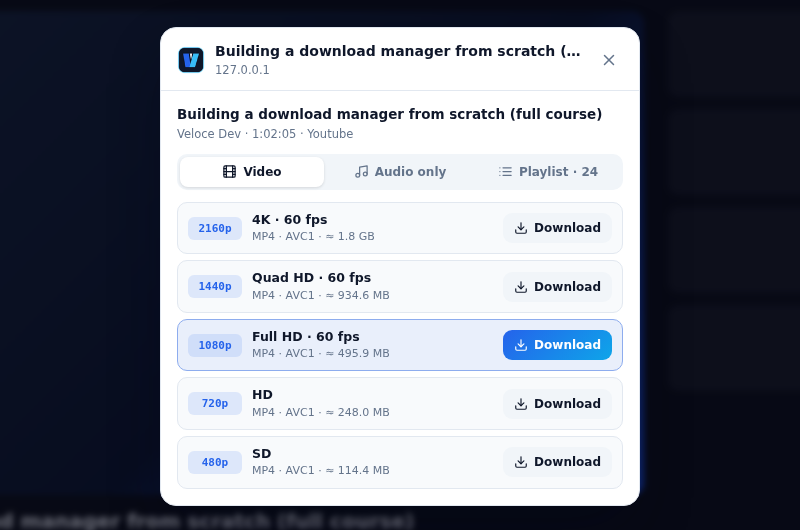
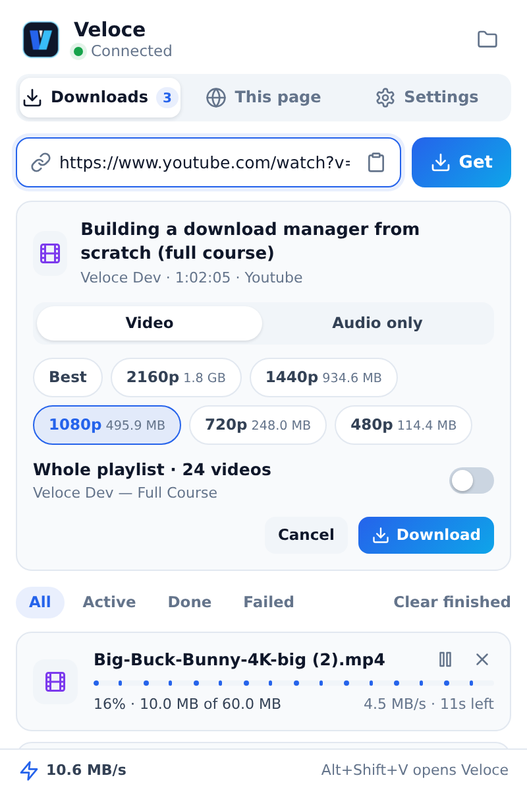
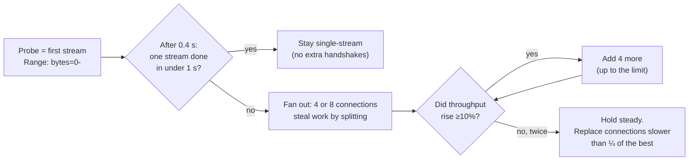

<div align="center">


# Veloce

**A small, fast, open-source download manager.**
Adaptive multi-connection downloads, one-click video & audio from YouTube, TikTok, Instagram and 1,800+ sites, a browser extension, and a desktop dashboard — in a ~22 MB background process.

[](https://github.com/Firojpaudel/veloce/actions/workflows/ci.yml)
[](https://github.com/Firojpaudel/veloce/releases)
[](LICENSE)


[Download](#install) · [Features](#features) · [How it works](#how-the-engine-works) · [Benchmarks](#benchmarks) · [FAQ](#faq)



</div>

---

## Features

**Faster downloads, without guesswork**
- **Adaptive connections.** Starts streaming on one connection immediately, measures, and only opens more (up to 32) while they actually raise throughput. Small files on fast CDNs stay single-stream; throttled or far-away servers fan out wide.
- **Work stealing.** When a connection finishes, it takes over half of whichever connection will finish *last* — so one slow socket never holds up the whole file.
- **Slow-connection replacement.** A connection running far below the others is dropped and its range re-requested on a fresh socket.
- **Keep-alive reuse.** Connections are reused across pieces, so stealing work doesn't cost a new TCP + TLS handshake.
- **Pause, resume, retry.** Downloads survive pauses and failures; history survives restarts.
- **Never corrupts or clobbers.** Servers that ignore ranges are detected and handled safely; existing files are never overwritten (`file (1).zip`).

**Video & audio from the page you're on**
- A **Download** button appears on the video you hover — YouTube (incl. Shorts), TikTok, Instagram Reels and posts, X, Facebook, Vimeo, Reddit, and plain HTML5 players.
- Pick a resolution (4K → 144p), or **audio only** as MP3, M4A, Opus or FLAC.
- **Playlists:** open a video inside a playlist and choose *this video* or *the whole playlist* (queued, three at a time, saved in their own folder).
- Login-only and private videos work through your browser's existing session — cookies go only to the engine on your own computer.
- Streams that pages hide behind `blob:` players (HLS / DASH) are detected automatically.

**Feels like an app, not a script**
- **Desktop dashboard** with categories, search, paste-anywhere (`Ctrl+V`), and keyboard shortcuts.
- **Tray icon** so you always know it's running; optional **start at login**.
- **Browser integration**: catches normal browser downloads (with Chrome's own filename, referrer and login) and falls back to the browser's downloader whenever the engine is off — nothing is ever lost.
- Light and dark themes everywhere.

| Extension | Video picker on any page |
| :---: | :---: |
|   | <br><br> |

<sub>Screenshots use demo data.</sub>

---

## Install

### 1. The app (engine + dashboard)

| Platform | Download |
| :--- | :--- |
| Windows 10/11 | [veloce-windows-x64.exe](https://github.com/Firojpaudel/veloce/releases/latest/download/veloce-windows-x64.exe) |
| macOS (Apple Silicon) | [veloce-macos-arm64](https://github.com/Firojpaudel/veloce/releases/latest/download/veloce-macos-arm64) |
| macOS (Intel) | [veloce-macos-x86_64](https://github.com/Firojpaudel/veloce/releases/latest/download/veloce-macos-x86_64) |
| Linux (x86-64) | [veloce-linux-x86_64](https://github.com/Firojpaudel/veloce/releases/latest/download/veloce-linux-x86_64) |

Run it. Veloce starts in your system tray and opens the dashboard. Turn on **Start at login** (offered on first launch) and you never have to think about it again. Launching it a second time just reopens the dashboard.

> **Windows shows "Windows protected your PC"?** That's SmartScreen warning about an *unsigned* app, not about anything the app does. Click **More info → Run anyway**. See the [FAQ](#faq) for why and how it goes away.
>
> **macOS says the app "can't be opened"?** Right-click → **Open** the first time, or run `xattr -d com.apple.quarantine veloce-macos-*`.

### 2. The browser extension (Chrome, Edge, Brave and other Chromium browsers)

1. Download and unzip [veloce-extension.zip](https://github.com/Firojpaudel/veloce/releases/latest/download/veloce-extension.zip) (or use the `extension/` folder of this repo).
2. Open `chrome://extensions`, turn on **Developer mode**, click **Load unpacked**, pick the folder.
3. Pin Veloce to the toolbar. `Alt+Shift+V` opens it.

### Run from source

```bash
pip install -r requirements.txt   # optional extras: yt-dlp (video), pystray + Pillow (tray icon)
python3 main.py                   # desktop app: engine + tray + dashboard
python3 main.py daemon            # headless engine in this terminal
python3 main.py download URL -c 16 -o ~/Downloads/
python3 main.py autostart enable  # start at login (Windows, macOS, Linux)
```

The engine itself uses only the Python standard library (3.10+). For video/audio, install `ffmpeg` too (merges HD video with audio and converts to MP3).

---

## How the engine works



1. **The probe is the download.** Veloce opens the file with an open-ended range request and keeps reading it, so the first bytes arrive after one round trip. Servers that don't support ranges get exactly one request.
2. **Decide with data, not a fixed number.** After 0.4 s it knows the real single-stream speed. If one stream will finish within a second, extra connections would only cost handshakes, so it doesn't open any.
3. **Ramp while it helps.** Connections are added in steps; each step is judged after the server's measured response delay (so slow-to-start servers aren't misjudged), and the ramp stops after two flat measurements.
4. **Split the tail, not the biggest chunk.** Idle connections split the segment with the **longest time remaining** (bytes left ÷ that connection's speed). Splitting by bytes alone ignores that a slow connection with less left is often the one everything waits on.
5. **Write in place.** Each connection writes at its own offset (`pwrite` on macOS/Linux, a locked seek+write on Windows) into a pre-allocated file. There's no merge step and no buffering of the file in memory.

Pages are resolved by [yt-dlp](https://github.com/yt-dlp/yt-dlp) in a **short-lived helper process**: the engine never loads it, so its memory goes back to the system the moment a video job ends, and a crashing extractor can't take the engine down.

---

## Benchmarks

<picture>
  <source media="(prefers-color-scheme: dark)" srcset="assets/benchmark-dark.svg">
  
</picture>

| Source | Size | Single stream | Veloce 1.0 (fixed 16) | **Veloce 1.1 (adaptive)** |
| :--- | ---: | ---: | ---: | ---: |
| Internet Archive | 59 MB | 0.43 MB/s | 4.47 MB/s | **5.33 MB/s** |
| Kernel.org CDN | 6.6 MB | 11.05 MB/s | 5.62 MB/s | **10.39 MB/s** |
| Python.org (Fastly) | 19 MB | 6.97 MB/s | 7.47 MB/s | **8.35 MB/s** |
| Apache archive | 9.4 MB | 1.42 MB/s | 2.84 MB/s | **2.59 MB/s** |
| SoundHelix | 8.5 MB | 1.87 MB/s | 1.78 MB/s | **1.50 MB/s** |

**What this shows, honestly:**
- **Where multi-connection wins, it wins big:** ~12× over a single stream on Internet Archive, whose servers throttle each connection.
- **On fast CDNs, Veloce 1.1 no longer loses:** 1.0 always opened 16 connections and was ~2× *slower* than a single stream on Kernel.org; 1.1 stays near single-stream speed there.
- **Some servers can't be sped up.** Apache's archive caps each IP; SoundHelix is small and varies a lot run to run. No downloader beats a per-IP limit, and those numbers are within noise.
- Internet speeds swing between runs (single-stream Python.org ranged from 2 to 16 MB/s in one session). Treat these as one home connection on one day — and [run it yourself](scripts/benchmark_suite.py).

<details>
<summary>Methodology</summary>

Mean of three runs per source and variant, alternating variants within each round to spread out network drift. "Single stream" is one plain HTTP GET (what a browser does). Two large sources cap the single-stream baseline at 20–25 MB, so compare **rates**, not times. Chart: `scripts/render_benchmark_chart.py`.
</details>

### Resource use

Measured on Linux (Python 3.10), engine only:

| State | Memory (RSS) | Threads |
| :--- | ---: | ---: |
| Idle | ~22 MB | 1 |
| Polled every second by the extension | ~24 MB | 1 |
| Downloading 200 MB over 16 connections | ~24 MB | 1 + 1 per connection |
| After a YouTube download (yt-dlp ran in a helper) | ~22 MB | 1 |

Data streams straight to disk, so memory doesn't grow with file size. The tray icon (pystray + Pillow) adds roughly 10 MB in the desktop app.

---

## Veloce compared

[Mister Download Manager (MDM)](https://github.com/anefzaoui/misterdownloadmanager) is a much larger, mature Rust app — torrents, FTP, debrid services, schedulers, a VPN kill switch, 86 languages. If you want every feature, use it. Veloce aims to be the small, readable option that's excellent at the two things most people download: files and videos.

| | Veloce | MDM |
| :--- | :--- | :--- |
| License | MIT | GPL-3.0 |
| Platforms | Windows, macOS, Linux | Windows, Linux; macOS marked experimental |
| Starting connections | One stream first; fans out only if one stream would take > 1 s | One connection per chunk of file size, up to 8 by default |
| Adding connections | Ramps in steps while measured throughput keeps rising | Fixed by the start rule and user setting |
| Work stealing | Splits the segment that will finish **last** (bytes left ÷ its speed) | Splits the **largest** remaining segment |
| Slow-connection replacement | ✓ (below ¼ of the best) | ✓ (below ¼ of the best) |
| Keep-alive reuse · probe is first stream | ✓ · ✓ | ✓ · ✓ |
| Video, playlists, audio-only | ✓ via yt-dlp, self-updating | ✓ via yt-dlp |
| Login-only videos via your browser session | ✓ | Not stated |
| Torrents, FTP, debrid, scheduler, speed limits | — | ✓ |
| Languages, accessibility | English | 86 languages, screen readers |
| Engine | Python, standard library only, ~22 MB RSS | Native Rust |
| Size of codebase | ~6k lines (engine ~3k) | Large Cargo workspace |

MDM details are from its README and source as of November 2026. Neither project has been benchmarked against the other on the same machine — that's welcome as a contribution.

---

## Security & privacy

The engine listens on `127.0.0.1:9229` only, and treats every request as untrusted:

- **Only the extension and the dashboard can call it.** Requests from web pages are rejected by exact `Origin` matching (look-alikes such as `http://localhost.evil.com` and other local apps' ports included), and a `Host` check blocks DNS-rebinding.
- **Downloads can only be saved inside your Veloce folder**, only `http(s)` links are accepted, and inputs are validated.
- **Your cookies stay local.** The extension sends site cookies only to the engine on your machine; they are dropped automatically if a download redirects to another site, written to a private temporary file for yt-dlp, and deleted when the job ends. They're never saved to history.
- **Updates are verified.** yt-dlp updates come from PyPI over HTTPS and are checked against PyPI's SHA-256 before use.
- Optional: set `VELOCE_EXTENSION_IDS=<id>` to accept only your installed extension.

See [`tests/test_regressions.py`](tests/test_regressions.py) and [`tests/test_features.py`](tests/test_features.py).

---

## FAQ

**Why does Windows warn that the app is unsafe?**
SmartScreen warns about any executable that isn't **code-signed** and hasn't built up a download reputation yet. It isn't detecting anything in Veloce. The fix is signing: the release workflow already has a signing step that switches on when a certificate is added as a repository secret. Open-source projects can get a certificate for free through [SignPath Foundation](https://signpath.org).

**Do I need to update yt-dlp myself?**
No. Video sites change often, so the engine checks PyPI once a day, downloads and verifies a newer yt-dlp in the background, and every new video job uses it. If an update ever fails to load, Veloce keeps using the version it shipped with. Disable with `VELOCE_NO_AUTO_UPDATE=1`.

**Is there a phone app?**
Not yet. Android is realistic (a native app can run the same engine logic). iOS doesn't allow background download managers or browser extensions of this kind outside Safari's limits, so an iPhone version would be a much smaller "share a link → save" app. Contributions welcome.

**Can it download from Spotify or Netflix?**
No, and it won't. Those streams are DRM-encrypted; breaking that is illegal in most countries. Veloce only downloads what the site serves openly.

**Where do downloads go?**
`~/Downloads/veloce` (change with `VELOCE_DOWNLOAD_DIR`). History and logs live in `~/.veloce`.

**The extension says "Engine off".**
Start the app (or enable start at login). While it's off, files still download through the browser normally; video grabbing needs the engine.

---

## Development

```bash
python3 -m unittest discover -s tests      # 31 tests, no network needed
npm run check:js                           # syntax-check extension + dashboard scripts
python3 scripts/generate_icons.py          # re-render icons from the vector mark
python3 scripts/package_extension.py       # build dist/veloce-extension.zip
python3 scripts/benchmark_suite.py         # real-world benchmark (uses the internet)
```

| Path | What's there |
| :--- | :--- |
| `engine/segmenter.py` | The download engine: probing, adaptive connections, work stealing, pause/resume |
| `engine/server.py` | Local API + dashboard server, task store, security checks |
| `engine/media.py`, `media_worker.py` | yt-dlp integration, run in a helper process |
| `engine/updater.py` | Verified yt-dlp self-update |
| `engine/ui/` | Desktop dashboard (plain HTML/CSS/JS, no build step) |
| `engine/tray.py`, `autostart.py` | Tray icon, start at login |
| `extension/` | Chrome/Edge extension (Manifest V3) |

Releases: push a `v*` tag. CI runs the tests on Windows, macOS and Linux, builds all four binaries, smoke-tests them, and publishes them with SHA-256 checksums.

## License

[MIT](LICENSE)
