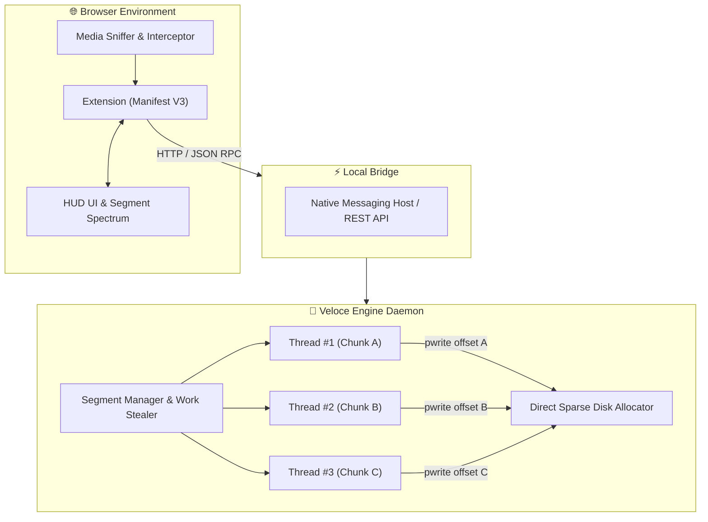

# ⚡ VELOCE
### High-Performance Dynamic Multi-Stream Download Accelerator & Media Sniffer

> **Open-Source, Trademark-Safe, Zero-Bloat Alternative to Proprietary Download Accelerators.**

---

## 🌟 Why Veloce? The Technical Breakdown

Most download managers claim to accelerate downloads, but under the hood, almost all of them fall short of true line-rate saturation. Here is why **Veloce** is built differently:

| Feature | Standard Browser | Static Chunk Downloaders (Aria2/Motrix default) | Veloce Accelerator |
| :--- | :--- | :--- | :--- |
| **Connection Strategy** | Single connection | Static chunk partition (e.g., 8 fixed cuts) | **Dynamic Segment Bisection (Work-Stealing)** |
| **Slow Thread Bottleneck** | Catastrophic | Vulnerable (stuck waiting for slowest chunk) | **Zero Bottleneck (Fast threads split slow chunks)** |
| **Disk Reassembly** | Direct | Slow sequential concatenation (`cat part* > file`) | **Zero-Overhead Sparse In-Place Pwrite** |
| **Socket Reuse** | Basic | Varies | **Persistent Keep-Alive Connection Pools** |
| **Browser Extension** | Native | Basic RPC forwarder | **Manifest V3 + Real-Time Hologram Spectrum + Media Sniffer** |

---

## 🧠 Core Architecture: Dynamic File Segmentation

Unlike naive multi-connection downloaders that statically divide a 500 MB file into fixed slices, Veloce implements **active runtime work-stealing**:



1. **Dynamic Bisection**: If Connection #1 finishes its segment while Connection #2 is progressing through a large chunk, Connection #1 splits the unreceived byte range of Connection #2 in half (`split_point = current + rem // 2`) and commands an HTTP range request for `Range: bytes=split_point+1-end`.
2. **Zero Post-Processing Reassembly Delay**: Files are written directly to their target byte offsets in the destination file using sparse random-access seek/write (`pwrite`). When the final byte arrives from the network, the file is already 100% complete—no multi-minute waiting for parts to be stitched together.

---

## 🎨 Veteran UI / UX Design

- **HUD Bandwidth Meter**: Tabular numerical typography with live auto-scaling (`MB/s` / `KB/s`) and active thread gauges.
- **Dynamic Segment Hologram**: Live multi-track visual spectrum rendering of every active connection thread with fluid animations and status states.
- **In-Page Floating Video Sniffer**: A frosted-glass floating pill docked to HTML5 `<video>` and `<audio>` players across the web for 1-click accelerated media extraction.
- **Clipboard Intelligence**: Auto-detection and 1-click paste for accelerated links.

---

## 🚀 Quickstart Guide

### 1. Prerequisites
- Python 3.8+ (zero external pip dependencies required for core functionality)
- Any Chromium-based browser (Google Chrome, Brave, Microsoft Edge, Chromium, Opera) or Firefox

### 2. Start the Veloce Core Daemon
```bash
# Start background engine daemon on 127.0.0.1:9229
python3 main.py daemon
```

### 3. Load the Browser Extension
1. Open your browser and navigate to:
   - Chrome / Brave / Edge: `chrome://extensions`
2. Enable **Developer mode** (top-right toggle).
3. Click **Load unpacked**.
4. Select the `extension/` directory from this repository.

*(Optional)* Register the Linux Native Messaging Host for direct stdio communication:
```bash
./native_host/install_native_host.sh
```

### 4. CLI Direct Usage
You can also use Veloce directly from the terminal without opening the browser:
```bash
# Download a file with 16 dynamic connections
python3 main.py download https://example.com/largefile.iso -c 16 -o ~/Downloads/
```

---

## 🧪 Testing

Run unit tests verifying thread-safe dynamic segmentation and work stealing:
```bash
python3 -m unittest discover -s tests
```

---

## 📄 License & Attribution

Designed and engineered by **Firoj Paudel** ([@Firojpaudel](https://github.com/Firojpaudel)).  
Licensed under the **MIT License**.
