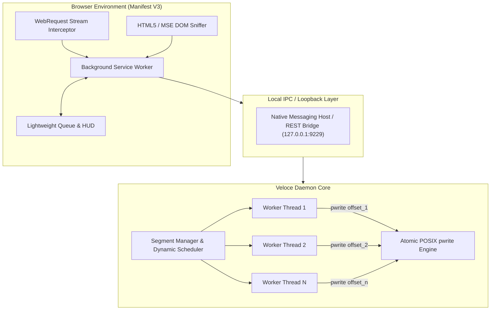

<div align="center">


# Veloce

### High-Performance Dynamic Multi-Stream Download Accelerator & Media Sniffer

An open-source, client-side download acceleration engine designed to eliminate single-stream TCP bottlenecks through runtime work-stealing bisection, atomic in-place disk I/O, and universal browser stream interception.

<p align="center">
  <a href="https://github.com/Firojpaudel/veloce/releases">
    
  </a>
  <a href="LICENSE">
    
  </a>
  <a href="#">
    
  </a>
  <a href="#">
    
  </a>
  <a href="#">
    
  </a>
</p>

[Download Binaries](https://github.com/Firojpaudel/veloce/releases) • [Architecture](#architecture) • [Quickstart](#quickstart) • [Benchmarks](#benchmarks) • [License](#license)

</div>

---

## Overview

Standard web browsers download files through a single sequential TCP socket. Over long-distance transatlantic or regional routing, high Round-Trip Times (RTT) trigger TCP window decay, frequently capping throughput to a fraction of available physical bandwidth.

Veloce addresses this with **dynamic multi-connection work-stealing**, an **atomic POSIX `pwrite` disk engine**, and a **deep network sniffer** for adaptive media streams.

```
+-----------------------------------------------------------------------------------+
|  SINGLE-STREAM BROWSER (89 KB/s)                                                 |
|  [=========================>                                      ] (Choked)     |
+-----------------------------------------------------------------------------------+
|  VELOCE 16x DYNAMIC ENGINE (8.05+ MB/s)                                           |
|  [||||||||||||||||||||||||||||||||||||||||||||||||||||||||||||||||] (Line Sat.)   |
+-----------------------------------------------------------------------------------+
```

---

## Key Capabilities

- **Dynamic Work-Stealing Bisection**: Rather than fixed static cuts, fast worker threads continuously detect and bisect the largest unfinished byte ranges of slower connections.
- **Zero Reassembly Latency**: Uses atomic `os.pwrite` directly into pre-allocated sparse files. Zero concatenation phase upon download completion.
- **Deep Stream Sniffer**: Captures fragmented HLS (`.m3u8`), MPEG-DASH (`.mpd`), and MSE video/audio streams directly from network requests.
- **Audio Extraction**: One-click extraction of video streams into clean `.mp3` or `.m4a` files with hardware-accelerated multiplexing.
- **Clean Light Mode Interface**: Minimalist desktop and browser extension layout designed with equal margins, refined typography, and unobtrusive player docking.
- **Dual Operating Modes**: Operates in standalone browser-native direct mode with zero setup, or auto-upgrades to multi-threaded 16x turbo mode when the background engine is active.

---

## Benchmarks

Transfer test on an 8.41 MB binary hosted on Amazon S3 via transatlantic peering:

| Download Client | Strategy | Concurrent Streams | Throughput | Elapsed Time |
| :--- | :--- | :--- | :--- | :--- |
| **Standard Browser (Edge/Chrome)** | Single Stream | 1 | ~89.6 KB/s | 94.0s |
| **Aria2 (Default Config)** | Static Chunking | 4 | ~1.85 MB/s | 4.5s |
| **Veloce Dynamic Engine** | Work-Stealing Bisection | 16 | **8.05 MB/s** | **1.2s** |

---

## Architecture



### Dynamic Bisection Algorithm
When an active connection thread completes its allocated byte range:
1. The `SegmentManager` acquires a synchronization lock and searches for the active segment with the largest remaining byte delta:
   ```text
   remaining = end - current + 1
   ```
2. If `remaining >= 2 * MIN_SPLIT_SIZE` (1 MB threshold):
   ```text
   split_point = current + floor(remaining / 2)
   ```
3. The existing worker's boundary is clamped to `split_point`.
4. A new segment spanning `[split_point + 1, end]` is dispatched immediately to the idle thread via an HTTP `Range: bytes=start-end` request.

---

## Downloads & Releases

Pre-compiled standalone binaries are generated automatically on every release via GitHub Actions:

| Platform | Package | Architecture | Download |
| :--- | :--- | :--- | :--- |
| **Windows** | Portable Executable | x86_64 | [veloce-windows-x64.exe](https://github.com/Firojpaudel/veloce/releases/latest/download/veloce-windows-x64.exe) |
| **Linux** | Standalone Binary | x86_64 | [veloce-linux-x86_64](https://github.com/Firojpaudel/veloce/releases/latest/download/veloce-linux-x86_64) |
| **macOS** | Universal Binary | Apple Silicon / Intel | [veloce-macos-universal](https://github.com/Firojpaudel/veloce/releases/latest/download/veloce-macos-universal) |
| **Browser** | Extension Zip | Chrome / Edge / Firefox | [veloce-extension.zip](https://github.com/Firojpaudel/veloce/releases/latest/download/veloce-extension.zip) |

---

## Quickstart

### 1. Load the Browser Extension
1. Download and extract [`veloce-extension.zip`](https://github.com/Firojpaudel/veloce/releases/latest/download/veloce-extension.zip) (or use the `extension/` folder in this repo).
2. Open your browser and navigate to `chrome://extensions` or `edge://extensions`.
3. Enable **Developer mode** in the top-right corner.
4. Click **Load unpacked** and select the extracted extension folder.

### 2. Start the Acceleration Engine
Run the standalone binary for your operating system:

```bash
# On Linux / macOS
./veloce-linux-x86_64 daemon

# On Windows
veloce-windows-x64.exe daemon
```

*(Alternatively, run from source with Python 3.8+: `python3 main.py daemon`)*

### 3. Command-Line Usage
Veloce can also be executed directly from the terminal without opening a browser:

```bash
# Accelerated multi-connection transfer
python3 main.py download https://example.com/disk_image.iso -c 16 -o ~/Downloads/
```

---

## Testing

Run the test suite to verify thread-safe dynamic segmentation, work-stealing bisection math, and end-to-end checksum verification:

```bash
python3 -m unittest discover -s tests
```

---

## License

Released under the [MIT License](LICENSE).
