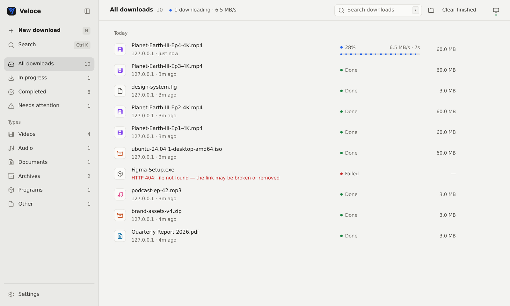
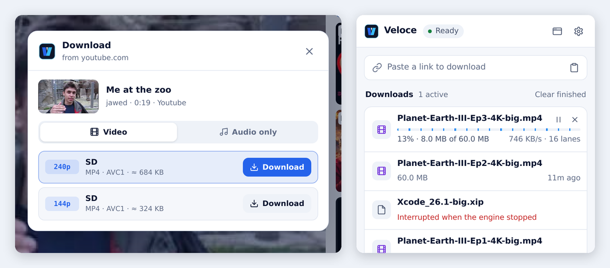
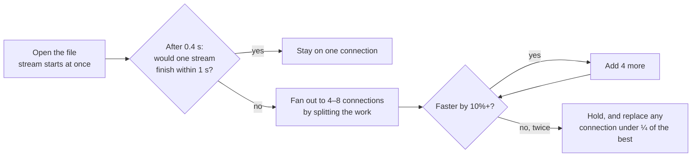
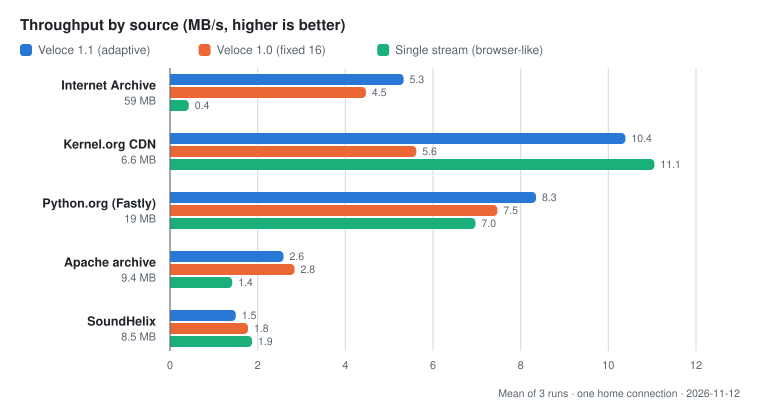

<div align="center">


<h1>Veloce</h1>

<p><strong>Downloads that finish sooner. Videos in one click.</strong><br/>
A small, open-source download manager for Windows, macOS and Linux.</p>

<p>
  <a href="https://github.com/Firojpaudel/veloce/releases/latest"></a>
  <a href="https://github.com/Firojpaudel/veloce/actions/workflows/ci.yml"></a>
  <a href="LICENSE"></a>
</p>

<p>
  <a href="#install"><strong>Install</strong></a> ·
  <a href="#how-it-works">How it works</a> ·
  <a href="#benchmarks">Benchmarks</a> ·
  <a href="#faq">FAQ</a>
</p>



</div>

<br/>

<table>
<tr>
<td width="33%" valign="top">

**Faster where it counts**

Veloce opens extra connections only when they actually make a download faster — 10× on throttled servers, never slower on fast ones.

</td>
<td width="33%" valign="top">

**Any video, one click**

A Download button on the video you're watching: YouTube, Shorts, TikTok, Instagram Reels, X and 1,800+ sites, as video or MP3.

</td>
<td width="33%" valign="top">

**Stays out of the way**

Lives in your tray at about 22 MB of memory, catches browser downloads, and updates its video support by itself.

</td>
</tr>
</table>

## In your browser

<p align="center">
  
</p>

<p align="center"><sub>
<b>Left:</b> hover any video and press <b>Download</b> — pick a quality, audio only, or the whole playlist.
&nbsp;·&nbsp;
<b>Right:</b> the toolbar popup — paste a link and watch live progress; each blue lane is one connection.
<br/>Real captures of the extension and app. Download names are test files from a local server.
</sub></p>

## Install

**1 · Get the app**

| Windows 10/11 | macOS (Apple Silicon) | macOS (Intel) | Linux |
| :---: | :---: | :---: | :---: |
| [**veloce-windows-x64.exe**](https://github.com/Firojpaudel/veloce/releases/latest/download/veloce-windows-x64.exe) | [**veloce-macos-arm64**](https://github.com/Firojpaudel/veloce/releases/latest/download/veloce-macos-arm64) | [**veloce-macos-x86_64**](https://github.com/Firojpaudel/veloce/releases/latest/download/veloce-macos-x86_64) | [**veloce-linux-x86_64**](https://github.com/Firojpaudel/veloce/releases/latest/download/veloce-linux-x86_64) |

Open it. Veloce settles into your system tray and opens its window.

> [!WARNING]
> **First launch may show a security prompt** because the app isn't code-signed yet — it's not about anything Veloce does.
> - **Windows** (“Windows protected your PC”): click **More info → Run anyway**.
> - **macOS** (“can't be opened”): right-click the file → **Open**, or run `xattr -d com.apple.quarantine veloce-macos-*`.

> [!TIP]
> Accept **Start at login** when Veloce offers it on first launch. It then runs quietly in your tray (about 22 MB of memory) and you never have to open it again.

**2 · Add the browser extension** (Chrome, Edge, Brave and other Chromium browsers)

1. Download and unzip [**veloce-extension.zip**](https://github.com/Firojpaudel/veloce/releases/latest/download/veloce-extension.zip).
2. Open `chrome://extensions`, turn on **Developer mode**, click **Load unpacked**, and choose the folder.
3. Pin Veloce to your toolbar. <kbd>Alt</kbd> <kbd>Shift</kbd> <kbd>V</kbd> opens it.

> [!IMPORTANT]
> Video and audio downloads need the **app running**. When it's off, the extension hands ordinary file downloads back to your browser, so nothing is ever lost — you just don't get the speed-up.

<details>
<summary><b>Run from source instead</b></summary>
<br/>

```bash
pip install -r requirements.txt   # optional: yt-dlp (video), pystray + Pillow (tray icon)
python3 main.py                   # the app: engine, tray icon and window
python3 main.py daemon            # engine only, in this terminal
python3 main.py download URL      # one download from the command line
python3 main.py autostart enable  # start at login
```

The engine needs only Python 3.10+. Install `ffmpeg` too for HD video (it merges video with audio) and MP3 conversion.
</details>

## What you get

|  |  |
| :--- | :--- |
| **Adaptive speed** | Starts on one connection, measures, and adds more only while throughput keeps rising. Slow connections are replaced; finished ones take over the slowest remaining work. |
| **Video & audio** | Every quality up to 4K, audio as MP3, M4A, Opus or FLAC, whole playlists queued three at a time. Login-only videos work through your browser session. |
| **Browser integration** | Catches normal downloads with Chrome's own filename and login, and hands them back to Chrome whenever the app is off — nothing is lost. Right-click any link → *Download with Veloce*. |
| **A real app** | Search, categories, a command palette (<kbd>Ctrl</kbd> <kbd>K</kbd>), paste-anywhere, keyboard shortcuts, light & dark themes, pause / resume / retry, history that survives restarts. |
| **Safe by default** | Never overwrites a file, never writes outside your Veloce folder, detects servers that would corrupt a split download. |

## How it works



<details>
<summary><b>The details</b></summary>
<br/>

1. **The first request is the download.** Veloce asks for the whole file and keeps reading that response, so data flows after a single round trip.
2. **Measure, then decide.** If one stream would finish in about a second, extra connections would only add handshakes — so it doesn't open any.
3. **Ramp while it helps.** Connections are added in steps, each judged after the server's measured response delay, so slow-to-start servers aren't misread.
4. **Split the tail, not the biggest piece.** A free connection takes half of whichever piece will finish *last* (bytes left ÷ that connection's speed).
5. **Write in place.** Each connection writes at its own offset into a pre-allocated file — no merge step, no file held in memory.

Videos are resolved by [yt-dlp](https://github.com/yt-dlp/yt-dlp) in a short-lived helper process, so its memory goes back to the system as soon as a job ends.
</details>

## Benchmarks



- **Throttled servers:** ~12× a single stream on Internet Archive.
- **Fast CDNs:** Veloce 1.0 was ~2× *slower* than a single stream on Kernel.org; 1.1 matches it.
- **Some servers can't be helped.** Apache's archive limits each IP; SoundHelix varies run to run. No downloader beats a per-IP cap.

> [!NOTE]
> Measured on one home connection on one day. Internet speeds swing a lot between runs, so treat these as a direction, not a promise — and [run the benchmark yourself](scripts/benchmark_suite.py).

<details>
<summary><b>Numbers & method</b></summary>
<br/>

| Source | Size | Single stream | Veloce 1.0 | **Veloce 1.1** |
| :--- | ---: | ---: | ---: | ---: |
| Internet Archive | 59 MB | 0.43 MB/s | 4.47 MB/s | **5.33 MB/s** |
| Kernel.org CDN | 6.6 MB | 11.05 MB/s | 5.62 MB/s | **10.39 MB/s** |
| Python.org (Fastly) | 19 MB | 6.97 MB/s | 7.47 MB/s | **8.35 MB/s** |
| Apache archive | 9.4 MB | 1.42 MB/s | 2.84 MB/s | **2.59 MB/s** |
| SoundHelix | 8.5 MB | 1.87 MB/s | 1.78 MB/s | **1.50 MB/s** |

Mean of three runs per source, alternating variants each round, on one home connection (2026-11-12). "Single stream" is one plain GET, like a browser. Internet speed swings a lot between runs — [run it yourself](scripts/benchmark_suite.py).

**Resource use** (Linux, engine only): ~22 MB idle, ~24 MB while downloading 200 MB over 16 connections, back to ~22 MB after a YouTube download. The tray icon adds about 10 MB.
</details>

## Compared with MDM

[Mister Download Manager](https://github.com/anefzaoui/misterdownloadmanager) is a larger, mature Rust app — torrents, FTP, debrid, schedulers, 86 languages. Pick it if you want everything. Veloce aims to be the small, readable option that's excellent at files and videos.

<details>
<summary><b>Side-by-side</b></summary>
<br/>

| | Veloce | MDM |
| :--- | :--- | :--- |
| License | MIT | GPL-3.0 |
| Starting connections | One first; fans out only if one would take > 1 s | By file size, up to 8 by default |
| Adding connections | Ramps while measured throughput keeps rising | Fixed by its start rule and settings |
| Work stealing | Splits the piece that will finish **last** | Splits the **largest** remaining piece |
| Slow-connection replacement · keep-alive · probe-as-first-stream | ✓ · ✓ · ✓ | ✓ · ✓ · ✓ |
| Video, playlists, audio | ✓ yt-dlp, self-updating | ✓ yt-dlp |
| Login-only videos via browser session | ✓ | Not stated |
| Torrents, FTP, debrid, scheduler, speed limits | — | ✓ |
| Engine | Python stdlib, ~22 MB | Native Rust |

From MDM's README and source, November 2026. The two haven't been benchmarked on the same machine yet — contributions welcome.
</details>

## Privacy & security

- **Local only.** The engine listens on `127.0.0.1` and accepts requests only from the Veloce extension and its own window — never from websites.
- **Your logins stay yours.** Site cookies go only to the app on your computer, are dropped if a download redirects to another site, and are never saved.
- **Contained.** Downloads can only be saved inside your Veloce folder; only `http(s)` links are accepted.
- **Verified updates.** yt-dlp updates are checked against PyPI's published SHA-256 before use.

## FAQ

> [!CAUTION]
> Only download what you have the right to keep. Veloce saves what sites serve openly; it does not and will not break DRM (Spotify, Netflix and similar).

<details>
<summary><b>Why does Windows warn me about the app?</b></summary>
<br/>
SmartScreen warns about any program that isn't code-signed and hasn't built a download reputation yet. The release workflow has a signing step that switches on once a certificate is added; open-source projects can get one free from <a href="https://signpath.org">SignPath Foundation</a>.
</details>

<details>
<summary><b>Do I need to update anything for videos to keep working?</b></summary>
<br/>
No. Video sites change often, so Veloce checks for a newer yt-dlp once a day, verifies it, and uses it for the next video. If an update ever fails, it keeps using the version it shipped with. Turn this off with <code>VELOCE_NO_AUTO_UPDATE=1</code>.
</details>

<details>
<summary><b>Is there a phone app?</b></summary>
<br/>
Not yet. Android is realistic. iOS doesn't allow background download managers or extensions like this outside Safari's limits, so an iPhone version would be a smaller "share a link → save" app.
</details>

<details>
<summary><b>Spotify or Netflix?</b></summary>
<br/>
No. Those streams are DRM-protected, and breaking that is illegal in most countries. Veloce downloads what sites serve openly.
</details>

<details>
<summary><b>Where do my files go?</b></summary>
<br/>
<code>~/Downloads/veloce</code> (change it with <code>VELOCE_DOWNLOAD_DIR</code>). History and logs are in <code>~/.veloce</code>.
</details>

<details>
<summary><b>The extension says the app is off.</b></summary>
<br/>
Open Veloce (or turn on start at login). Until then, files still download through your browser as usual; video grabbing needs the app.
</details>

## Development

```bash
python3 -m unittest discover -s tests      # 31 tests, no network needed
npm run check:js                           # syntax-check extension and app scripts
python3 scripts/package_extension.py       # build dist/veloce-extension.zip
python3 scripts/benchmark_suite.py         # real-world benchmark (uses the internet)
```

<details>
<summary><b>Project layout</b></summary>
<br/>

| Path | What's there |
| :--- | :--- |
| `engine/segmenter.py` | Download engine: adaptive connections, work stealing, pause/resume |
| `engine/server.py` | Local API and app server, task store, security checks |
| `engine/media.py` · `media_worker.py` | yt-dlp integration, run in a helper process |
| `engine/updater.py` | Verified yt-dlp self-update |
| `engine/ui/` | The app window (plain HTML/CSS/JS, no build step) |
| `engine/tray.py` · `autostart.py` | Tray icon, start at login |
| `extension/` | Browser extension (Manifest V3) |
</details>

Releases: push a `v*` tag. CI tests on Windows, macOS and Linux, builds all four binaries, smoke-tests them, and publishes them with SHA-256 checksums.

<div align="center">
<br/>
<sub>MIT licensed · Made with care for people who download a lot.</sub>
</div>
