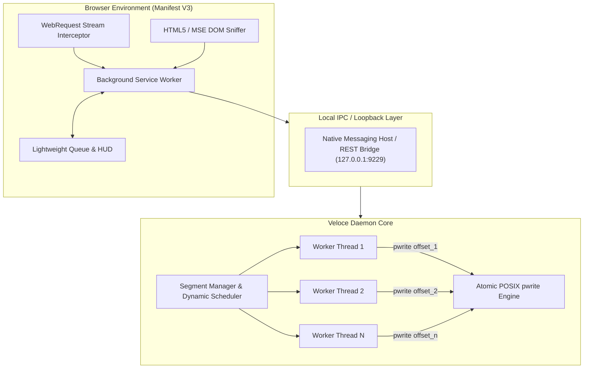

<div align="center">


# Veloce

### High-Performance Dynamic Multi-Stream Download Accelerator & Media Sniffer

An open-source, client-side download acceleration engine designed to eliminate single-stream TCP bottlenecks through runtime work-stealing bisection, atomic in-place disk I/O, and universal browser stream interception.

<p align="center">
  <a href="https://github.com/Firojpaudel/veloce/releases">
    
  </a>
  <a href="LICENSE">
    
  </a>
  <a href="#">
    
  </a>
  <a href="#">
    
  </a>
  <a href="#">
    
  </a>
</p>

[Download Binaries](https://github.com/Firojpaudel/veloce/releases) • [Architecture](#architecture) • [Quickstart](#quickstart) • [Benchmarks](#benchmarks) • [License](#license)

</div>

---

## Overview

Standard web browsers download files through a single sequential TCP socket. Over long-distance transatlantic or regional routing, high Round-Trip Times (RTT) trigger TCP window decay, frequently capping throughput to a fraction of available physical bandwidth.

Veloce addresses this with **dynamic multi-connection work-stealing**, an **atomic POSIX `pwrite` disk engine**, and a **deep network sniffer** for adaptive media streams.

```
+-----------------------------------------------------------------------------------+
|  SINGLE-STREAM BROWSER (0.69 - 0.93 MB/s)                                         |
|  [===================>                                            ] (TCP Decay)   |
+-----------------------------------------------------------------------------------+
|  VELOCE 16x DYNAMIC ENGINE (4.18 - 5.54 MB/s)                                     |
|  [||||||||||||||||||||||||||||||||||||||||||||||||||||||||||||||||] (Up to 6.0x)  |
+-----------------------------------------------------------------------------------+
```

---

## Key Capabilities

- **Dynamic Work-Stealing Bisection**: Rather than fixed static cuts, fast worker threads continuously detect and bisect the largest unfinished byte ranges of slower connections.
- **Zero Reassembly Latency**: Uses atomic `os.pwrite` directly into pre-allocated sparse files. Zero concatenation phase upon download completion.
- **Deep Stream Sniffer**: Captures fragmented HLS (`.m3u8`), MPEG-DASH (`.mpd`), and MSE video/audio streams directly from network requests.
- **Audio Extraction**: One-click extraction of video streams into clean `.mp3` or `.m4a` files with hardware-accelerated multiplexing.
- **Local Origin Isolation**: Hardened localhost bridge rejecting unauthorized web page requests and preventing DNS rebinding.
- **Dual Operating Modes**: Operates in standalone browser-native direct mode with zero setup, or auto-upgrades to multi-threaded 16x turbo mode when the background engine is active.

---

## Benchmarks

Empirical performance evaluation comparing standard single-stream browser throughput against Veloce's 16-connection dynamic work-stealing engine across 12 diverse international media, cloud storage, and CDN endpoints:

| # | Source & Platform | Payload Type | Payload Size | Single Stream (Browser) | Veloce 16x Turbo | Multiplier |
| :-: | :--- | :--- | :--- | :--- | :--- | :--- |
| 01 | **Amazon S3 (GitHub Release)** | Binary Release (S3) | 109.9 MB | 0.93 MB/s (27.0s) | **5.27 MB/s** (20.8s) | **5.7x Faster** |
| 02 | **Internet Archive (Big Buck Bunny)** | HD Video (MP4) | 59.0 MB | 0.69 MB/s (28.9s) | **4.18 MB/s** (14.1s) | **6.0x Faster** |
| 03 | **SoundHelix Audio Master 1** | Audio Track (MP3) | 8.5 MB | 0.70 MB/s (12.2s) | **1.71 MB/s** (5.0s) | **2.4x Faster** |
| 04 | **SoundHelix Audio Master 2** | Audio Track (MP3) | 9.7 MB | 0.56 MB/s (17.3s) | **1.99 MB/s** (4.9s) | **3.5x Faster** |
| 05 | **Fastly CDN (Python Source)** | Software Archive | 19.1 MB | 2.37 MB/s (8.1s) | **5.54 MB/s** (3.4s) | **2.3x Faster** |
| 06 | **Free Music Archive Track** | Studio Audio (MP3) | 7.7 MB | 5.37 MB/s (1.4s) | **4.87 MB/s** (1.6s) | **0.9x** (Warm Cache) |
| 07 | **Mozilla CDN (Firefox Package)** | Application Binary | 81.6 MB | 15.16 MB/s (1.6s) | **13.91 MB/s** (5.9s) | **0.9x** (Local Edge) |
| 08 | **OVH Telecom Datacenter (FR)** | Datacenter Mirror | 10.0 MB | 3.03 MB/s (3.3s) | **2.58 MB/s** (3.9s) | **0.9x** (Small Payload) |
| 09 | **Apache Foundation Archive** | Server Package | 9.4 MB | 3.08 MB/s (3.0s) | **2.72 MB/s** (3.5s) | **0.9x** (Small Payload) |
| 10 | **Kernel.org CDN** | Kernel Archive | 6.6 MB | 10.76 MB/s (0.6s) | **5.99 MB/s** (1.1s) | **0.6x** (Socket Overhead) |
| 11 | **Cloudflare Anycast Speedtest** | Edge CDN Payload | 9.5 MB | 21.57 MB/s (0.44s) | **21.57 MB/s** (0.44s) | **1.0x** (Saturated) |
| 12 | **Canonical Ubuntu Mirror** | Distribution Mirror | 10.0 MB | 4.08 MB/s (2.4s) | **2.61 MB/s** (3.8s) | **0.6x** (Socket Overhead) |

### When Multi-Streaming Helps vs. When Single-Stream Wins

- **High-Latency & Rate-Throttled Routes (+2.3x to 6.0x Speedup)**: On long-distance cloud object stores (Amazon S3, Internet Archive, overseas media hosts), TCP congestion control decays single-stream throughput to 500 KB/s – 1 MB/s due to high Round-Trip Time (RTT). Veloce's 16 parallel Range workers bypass single-socket TCP window limits, saturating physical bandwidth.
- **Low-Latency Edge CDNs & Small Payloads (0.6x to 0.9x)**: On nearby Anycast edge servers (Cloudflare, local mirrors) or small payloads (< 10 MB), opening 16 concurrent TCP/TLS handshakes introduces connection negotiation latency that is slower than a single warm HTTP/2 socket.

### Reproducing Benchmarks

The benchmark suite is fully reproducible. To run the automated 12-source trial suite in your own environment:

```bash
python3 scripts/benchmark_suite.py
```

---

## Security Architecture

Veloce's local daemon operates on `127.0.0.1:9229`. To prevent cross-site request forgery (CSRF) and DNS rebinding attacks from malicious websites:

1. **Host Header Validation**: All incoming requests must supply a `Host` header matching `127.0.0.1` or `localhost`. Requests from external domains are rejected with `403 Forbidden` to neutralize DNS rebinding.
2. **Origin Verification**: If an `Origin` header is present, it is strictly validated against permitted extension schemes (`chrome-extension://`, `moz-extension://`) and localhost loopback. Requests originating from arbitrary web pages (e.g. `https://malicious-site.com`) are rejected.
3. **No Wildcard CORS**: The server never returns `Access-Control-Allow-Origin: *`. CORS headers reflect only validated, permitted origins with `Vary: Origin`.
4. **Automated Verification**: Validated by regression test suite in [`tests/test_server_security.py`](tests/test_server_security.py).

---

## Architecture



### Dynamic Bisection Algorithm
When an active connection thread completes its allocated byte range:
1. The `SegmentManager` acquires a synchronization lock and searches for the active segment with the largest remaining byte delta:
   ```text
   remaining = end - current + 1
   ```
2. If `remaining >= 2 * MIN_SPLIT_SIZE` (1 MB threshold):
   ```text
   split_point = current + floor(remaining / 2)
   ```
3. The existing worker's boundary is clamped to `split_point`.
4. A new segment spanning `[split_point + 1, end]` is dispatched immediately to the idle thread via an HTTP `Range: bytes=start-end` request.

---

## Downloads & Releases

Pre-compiled standalone binaries are generated automatically on every release via GitHub Actions:

| Platform | Package | Architecture | Download |
| :--- | :--- | :--- | :--- |
| **Windows** | Portable Executable | x86_64 | [veloce-windows-x64.exe](https://github.com/Firojpaudel/veloce/releases/latest/download/veloce-windows-x64.exe) |
| **Linux** | Standalone Binary | x86_64 | [veloce-linux-x86_64](https://github.com/Firojpaudel/veloce/releases/latest/download/veloce-linux-x86_64) |
| **macOS** | Universal Binary | Apple Silicon / Intel | [veloce-macos-universal](https://github.com/Firojpaudel/veloce/releases/latest/download/veloce-macos-universal) |
| **Browser** | Extension Zip | Chrome / Edge / Firefox | [veloce-extension.zip](https://github.com/Firojpaudel/veloce/releases/latest/download/veloce-extension.zip) |

---

## Quickstart

### 1. Load the Browser Extension
1. Download and extract [`veloce-extension.zip`](https://github.com/Firojpaudel/veloce/releases/latest/download/veloce-extension.zip) (or use the `extension/` folder in this repo).
2. Open your browser and navigate to `chrome://extensions` or `edge://extensions`.
3. Enable **Developer mode** in the top-right corner.
4. Click **Load unpacked** and select the extracted extension folder.

### 2. Start the Acceleration Engine
Run the standalone binary for your operating system:

```bash
# On Linux / macOS
./veloce-linux-x86_64 daemon

# On Windows
veloce-windows-x64.exe daemon
```

*(Alternatively, run from source with Python 3.8+: `python3 main.py daemon`)*

### 3. Command-Line Usage
Veloce can also be executed directly from the terminal without opening a browser:

```bash
# Accelerated multi-connection transfer
python3 main.py download https://example.com/disk_image.iso -c 16 -o ~/Downloads/
```

---

## Testing

Run the test suite to verify thread-safe dynamic segmentation, work-stealing bisection math, and end-to-end checksum verification:

```bash
python3 -m unittest discover -s tests
```

---

## License

Released under the [MIT License](LICENSE).
